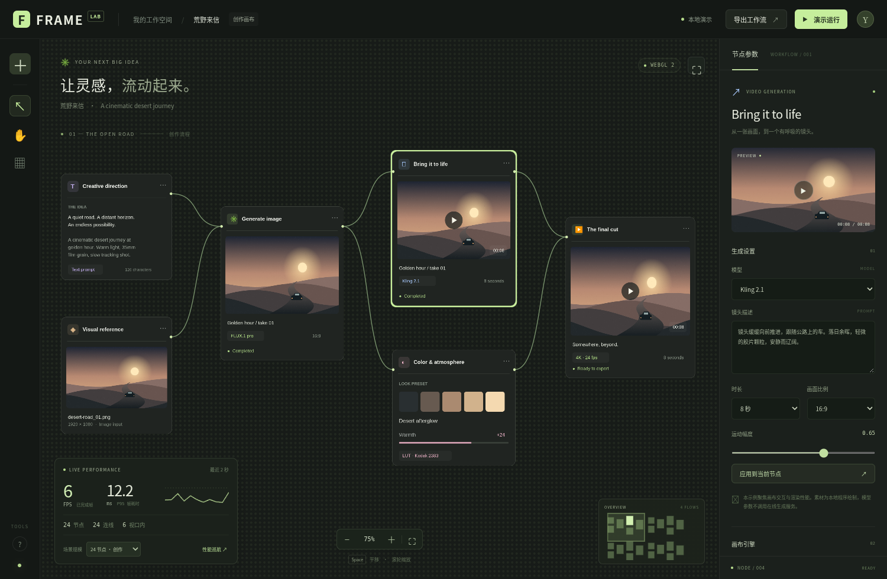

# FRAME — 节点创作工作台

一个基于本仓库 **ECS / WebGL 渲染器** 的媒体创作工作流示例，参考
TapNow、LibTV、Higgsfield 一类产品的使用场景。包含提示词、参考图、图像生成、
镜头运动、调色和输出六类节点，以及曲线连接、参数侧栏和实时性能面板。



## 文档站中的在线示例

中英文文档站的 Examples / 示例菜单均包含 FRAME，路径分别为
`/example/workflow-canvas` 和 `/zh/example/workflow-canvas`。
页面提供全屏和独立打开入口；独立应用位于 `/workflow-canvas/index.html`。

运行 `pnpm --filter @infinite-canvas-tutorial/site dev` 时，文档开发服务器会直接服务
此示例的源代码。运行文档站 `build` 时，VitePress 的 `buildEnd` 会把此应用打包到
文档输出目录，随现有 Vercel 发布流程一起上线，无需手工复制 `dist`。
示例在独立 iframe 中运行，其 CSS、全局事件和 ECS 运行时与文档页面隔离。

## 运行

在仓库根目录，使用 `.nvmrc` 指定的 Node.js 20 和 pnpm 9.15.9：

```sh
pnpm install --frozen-lockfile
pnpm example:workflow
```

也可以直接运行 `pnpm exec vite --config examples/workflow-canvas/vite.config.ts`。
无需先构建整个 monorepo；Vite 将 ECS 和 device-api 解析到本仓库源代码。
开发服务器使用端口 **4180**。示例不需要 API Key 或外部图片服务。

## 操作

-   点击节点查看参数；拖动节点会同步更新相连曲线。
-   拖动空白处、使用平移工具，或按住 **Space** 平移；滚轮以指针为中心缩放。
-   **V / H** 切换选择和平移；**F** 聚焦选中节点所属的工作流。
-   缩放工具右侧的全景按钮显示全部节点；点击右下角缩略图跳转。
-   切换 **24 / 120 / 600 / 2,400** 节点，观察不同规模的相机导航与全景渲染。
-   **性能巡航**执行约 10 秒的确定性缩放和平移，结束后显示本机结果；手动导航、
    再次点击、按 Escape 或切出页面会取消。遵循系统“减少动态效果”设置。
-   **＋** 添加一个六节点工作流；布局按钮恢复当前规模的默认布局。
-   参数可保存在当前页面会话中，导出 JSON 包含节点位置、连线、参数与相机。
    重载场景/页面会清空参数。模型名称是演示配置，不执行在线推理。
-   **演示运行**依次高亮一条工作流；预览按钮对本地静帧做镜头运动示意，
    不代表真实生成视频。

## 性能统计如何解读

FPS 根据实际完成的 `app.world.execute()` 次数与经过时间计算，而不是单独的 UI
`requestAnimationFrame` 回调。P95 是最近两秒完整 ECS 帧耗时的第 95 百分位，
包含异步等待，**不是 GPU timer 或纯 GPU 时间**。初次载入的预热阶段不计入稳定窗口。
曲线展示最近的真实帧耗时。页面进入后台会重置统计窗口并取消巡航。

面板的节点/连线数是逻辑图的规模；每个节点对应一个 GPU 纹理矩形，每条连线对应一个
路径实体，另有一个选择高亮矩形。“视口内”按逻辑卡片与相机视口的 AABB 相交计算，
不包含连线，也不是 GPU draw call 数。引擎仍执行自己的视口剔除与批处理。
全景与局部导航有不同的可见负载，不应将它们的帧率直接当作相同负载比较。

卡片内容先以 Canvas 2D 绘制为六张 2× PNG 缓存，通过共享 Blob URL 交给 ECS 的图片
填充渲染。重复工作流复用同类卡片纹理，节点数量不会增加页面 DOM 数量。
文字和预览图是卡片纹理的一部分，不为每个节点创建独立 DOM 或实时文字编辑器。
相机更新合并到 ECS 帧边界，不在每次导航时创建整份文档的历史快照。
大场景的增删按每帧 128 个形状分批提交，避免超过 ECS 默认的单帧变更日志容量。
页面卸载 / Vite 热更新会终止 App、取消计时器、移除全局监听并释放 Blob URL。

素材由示例自身的确定性绘图代码生成，无在线加载、第三方图片授权或网络抖动的干扰。
压力场景重复同一组六节点拓扑，适合复现实验；它不能代表任意复杂的生产项目。
帧率会受设备、分辨率、浏览器与软件/硬件 WebGL 后端影响，没有预设的性能保证。

## 验证

在仓库根目录：

```sh
pnpm exec tsc -p examples/workflow-canvas/tsconfig.json
pnpm exec eslint examples/workflow-canvas --max-warnings=0
pnpm build:workflow
pnpm test:workflow
pnpm test:workflow:docs
```

测试使用 Playwright Chromium。如需使用已安装的系统 Chromium：

```sh
WORKFLOW_CHROMIUM=/usr/bin/chromium pnpm test:workflow
```

文档集成测试覆盖中英文页面的实际 iframe 渲染、缩放、规模切换与独立入口。
设置 `WORKFLOW_DOCS_PREVIEW=1` 可以对已构建的文档预览运行相同测试。

浏览器回归覆盖图拓扑、缩放锚点、拖动、参数/导出、全部规模的增减切换、自动巡航、
窄屏与减少动态效果。测试从 ECS 文档读取实际节点/连线数量，防止仅 UI 计数变化。
浏览器测试显式使用软件 WebGL，以便在无独立 GPU 的 CI 中运行；测得数值不等同于
用户设备上的硬件加速表现。构建输出在此目录的 `dist/`，不影响其他示例。
