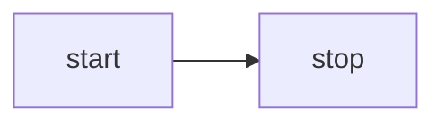

<script setup>
import Mermaid from '../../components/Mermaid.vue'
import MermaidRough from '../../components/MermaidRough.vue'
import MermaidFlowchart from '../../components/MermaidFlowchart.vue'
import MermaidFlowchartOutline from '../../components/MermaidFlowchartOutline.vue'
import MermaidSequence from '../../components/MermaidSequence.vue'
import MermaidState from '../../components/MermaidState.vue'
import D2 from '../../components/D2.vue'
import D2Containers from '../../components/D2Containers.vue'
import D2Connections from '../../components/D2Connections.vue'
import Drawio from '../../components/Drawio.vue'
</script>

# Lección 32 - De texto a diagrama {#lesson-32-text-to-diagram}

En la sesión anterior habilitamos la expresión de conexiones entre gráficos, así que ahora podemos renderizar muchos tipos de diagramas. Los modelos grandes ofrecen un soporte excelente para numerosos lenguajes de diagramas basados en texto, como [mermaid], [D2] y [draw.io].

## Mermaid {#mermaid}

Excalidraw ofrece la [mermaid-to-excalidraw/api]. Si te interesa su implementación interna, puedes leer la documentación oficial: [¿Cómo funciona el analizador por dentro?]


En resumen, Excalidraw solo admite un subconjunto limitado de tipos de diagrama de Mermaid. Analiza la salida SVG del renderizador de Mermaid, la convierte en una representación interna del diagrama de la escena y usa el JSON del diagrama obtenido del analizador para recuperar las relaciones entre nodos.

### Diagrama de flujo {#flowchart}

Toma como ejemplo el diagrama de flujo de Mermaid más sencillo de abajo:



Primero se usa la API obsoleta de Mermaid para analizar el texto, extrayendo tipos de diagrama, nodos y relaciones de aristas, pero sin información geométrica:

```ts
import mermaid, { MermaidConfig } from 'mermaid';
const diagram = await mermaid.mermaidAPI.getDiagramFromText(definition); // "flowchart LR..."
```

Después se usa el método de renderizado de Mermaid para dibujar el SVG en un contenedor oculto de la página. Esto también revela las limitaciones de este enfoque: solo se puede ejecutar en un entorno de navegador. Extrae la información geométrica de nodos y aristas de la salida SVG renderizada, usando los ID de nodo y de arista obtenidos en el paso anterior:

```ts
const { svg } = await mermaid.render('mermaid-to-excalidraw', definition);
```

Por último, conviértelo en un grafo de escena que acepte nuestro lienzo; el texto de los nodos crea nodos hijo separados:

```ts
function convertFlowchartToSerializedNodes(
    vertices: Map<string, Vertex>,
    edges: Edge[],
    options: { fontSize: number },
): SerializedNode[] {
    vertices.forEach((vertex) => {
        // Vertex
        const serializedNode: SerializedNode = {
            id: vertex.id,
            type: 'rect',
            x: vertex.x,
            y: vertex.y,
            width: vertex.width,
            height: vertex.height,
            stroke: 'black',
            strokeWidth: 2,
        };
        // Label of vertex
        const textSerializedNode: TextSerializedNode = {
            parentId: vertex.id,
            content: getText(vertex),
            //...
        };
    });
    // Edges
}
```

<Mermaid />

Basta con sustituir el tipo de los gráficos para lograr un renderizado con estilo dibujado a mano:

```ts
nodes.forEach((node) => {
    if (node.type === 'rect') {
        node.type = 'rough-rect';
    } else if (node.type === 'line') {
        node.type = 'rough-line';
    } else if (node.type === 'text') {
        node.fontFamily = 'Gaegu';
    }
});
```

<MermaidRough />

### Secuencia {#mermaid-sequence}

<MermaidSequence />

### [WIP] Estado {#mermaid-state}

## D2 {#d2}

En comparación con Mermaid, D2 incluye un analizador cómodo listo para usar.

```ts
import { D2 } from '@terrastruct/d2';

const d2 = new D2();
const { diagram, graph } = await d2.compile(definition);
const { connections, shapes } = diagram;
const {
    theme: { colors },
} = graph;
```

```txt
x -> y: hello world
```

<D2 />

Las conexiones se convierten en Paths enlazados a sus nodos extremos, con un trazo y `fills: []`. Rellenar un trazado abierto une de forma implícita sus extremos en un área, así que el color de la conexión no debe usarse también como relleno. Las conexiones siguen actualizándose cuando se mueven los nodos, y los marcadores dibujan las puntas de flecha.

### Contenedor {#container}

```txt
good chips: {
  doritos
  ruffles
}
bad chips.lays
bad chips.pringles

chocolate.chip.cookies
```

<D2Containers />

### Conexiones {#connections}

```txt
dogs -> cats -> mice: chase
replica 1 <-> replica 2
a -> b: To err is human, to moo bovine {
  source-arrowhead: 1
  target-arrowhead: * {
    shape: diamond
  }
}
```

<D2Connections />

## drawio {#drawio}

Hay un analizador de la comunidad:

```ts
import { parseDrawIO } from 'mxgraphdata';
const mxfile = await parseDrawIO(xml);
console.log(mxfile.diagram);
```

<Drawio />

## Etiqueta de arista {#label-on-edge}

Las etiquetas de texto de las aristas deben permanecer en una posición bien elegida a lo largo de la geometría; trataremos un enfoque general en la sección siguiente, [Lección 33 - Motor de maquetación]. Para este problema concreto, ayuda comparar cómo lo tratan Excalidraw, tldraw y draw.io.

### Nodo separado o atributo {#node-or-attribute}

En Excalidraw, colocar etiquetas de texto en las aristas (líneas y flechas) no consiste, en el fondo, en «hacer que el texto siga trazados o se ajuste a lo largo de curvas». En su lugar, se apoya en un enfoque más sencillo y fiable:

1. La etiqueta sigue siendo un elemento de texto independiente (no se renderiza como parte de la propia línea).
2. Enlaza el texto a la línea (flecha o línea) en los datos: el texto registra «a qué línea pertenece» y la línea registra «el ID de su texto de etiqueta» o una relación equivalente.
3. Usa cálculos geométricos para asignar un punto de anclaje al texto: normalmente el «punto medio» de la línea o un parámetro `labelPosition` (0~1), y después calcula el punto correspondiente según la forma de la línea (recta, poligonal o curva).
4. Trata el texto como un elemento enlazado: cuando la línea se mueve, se arrastran los extremos, cambian los codos o se invierten las flechas, se recalcula la posición de la etiqueta y se actualizan las coordenadas del texto (tratando también la evasión del solapamiento con la línea, el desplazamiento y la alineación).

tldraw adopta un enfoque distinto: la etiqueta no es una forma de texto separada, sino una prop (richText) de la propia forma flecha, combinada con un conjunto de interacciones de posicionamiento geométrico y de edición.

En draw.io, colocar etiquetas de texto en las aristas (conectores) es una de sus capacidades centrales. Su implementación se acerca más a los editores de diagramas de flujo tradicionales: «las aristas poseen su propia funcionalidad de etiqueta (texto), donde las etiquetas existen como estados hijo de la arista y las posiciones se guardan mediante parámetros geométricos o desplazamientos», en lugar de crear un nodo de texto separado y enlazarlo.

### Nuestra implementación {#our-implementation}

Seguimos el modelo al estilo de Excalidraw: el texto de la arista sigue siendo un nodo de texto independiente, unido a la polilínea mediante `parentId`, con `edgeLabelPosition` (0–1 a lo largo de la longitud de arco total de la polilínea) que indica en qué punto de la arista se sitúa.

```ts
export interface TextSerializedNode
  extends BaseSerializeNode<'text'>,
  Partial<TextAttributes>,
  Partial<{
    /**
     * When set, this text is an edge label: parent should be a bound polyline/line.
     * Value is 0–1 along total edge length (arc-length parameter).
     */
    edgeLabelPosition: number;
  }>;
```

<MermaidFlowchart />

### Mejorar la legibilidad {#improve-readability}

Las etiquetas de arista a menudo necesitan ajustes de legibilidad, sobre todo para no quedar justo encima del trazo.

#### Relleno de fondo {#label-background}

Un fondo opaco puede ocultar la línea que hay debajo.

-   mxGraph (draw.io): estilo `labelBackgroundColor`, por ejemplo `labelBackgroundColor=white` añade una caja blanca detrás de la etiqueta. `labelBorderColor` puede añadir un borde.
-   tldraw: las etiquetas de flecha no exponen una opción de fondo dedicada, pero las formas de texto admiten `showTextOutline` para un contraste mayor.
-   Excalidraw: como elementos de texto independientes, `backgroundColor` dibuja de forma automática un rectángulo relleno detrás del texto.

#### Espaciado y margen interno {#padding-inset}

El desplazamiento perpendicular y el padding interno mantienen los glifos físicamente alejados del trazo. Hemos añadido la propiedad `edgeLabelOffset` que, a diferencia de `edgeLabelPosition`, usa unidades absolutas para definir el desplazamiento a lo largo de la dirección de la normal.

#### Evitación automática {#conflict-avoidance}

Excalidraw y tldraw, como herramientas de estilo boceto, evitan una disposición automática pesada para los solapamientos; el usuario empuja las etiquetas a mano. mxGraph (draw.io), como editor de diagramas profesional, ofrece un control más fino del solapamiento.

#### Contorno de texto {#text-outline}

Una alternativa más ligera a un fondo completo: trazo o sombra alrededor de los glifos para dar contraste. tldraw dibuja un contorno fino detrás del texto cuando `showTextOutline` está activado, para que siga siendo legible al solaparse.

Ya presentamos este método en [Lección 16 - Trazo de texto].

<MermaidFlowchartOutline />

## [WIP] Saltos de línea {#line-jumps}


## Lectura adicional {#extended-reading}

-   [Discusión en HN]

[mermaid]: https://mermaid.js.org
[mermaid-to-excalidraw/api]: https://docs.excalidraw.com/docs/@excalidraw/mermaid-to-excalidraw/api
[¿Cómo funciona el analizador por dentro?]: https://docs.excalidraw.com/docs/@excalidraw/mermaid-to-excalidraw/codebase/parser
[D2]: https://github.com/terrastruct/d2
[draw.io]: https://app.diagrams.net/
[Discusión en HN]: https://news.ycombinator.com/item?id=44954524
[Lección 33 - Motor de maquetación]: /es/guide/lesson-033
[Lección 16 - Trazo de texto]: /es/guide/lesson-016#text-stroke
