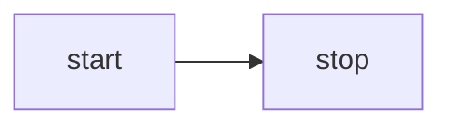

<script setup>
import Mermaid from '../../components/Mermaid.vue'
import MermaidRough from '../../components/MermaidRough.vue'
import MermaidFlowchart from '../../components/MermaidFlowchart.vue'
import MermaidFlowchartOutline from '../../components/MermaidFlowchartOutline.vue'
import MermaidSequence from '../../components/MermaidSequence.vue'
import MermaidState from '../../components/MermaidState.vue'
import D2 from '../../components/D2.vue'
import D2Containers from '../../components/D2Containers.vue'
import D2Connections from '../../components/D2Connections.vue'
import Drawio from '../../components/Drawio.vue'
</script>

# 第 32 課 - テキストからダイアグラム {#lesson-32-text-to-diagram}

前の課で図形どうしの接続を表現できるようにしたので、今では多くの種類のダイアグラムを描画できます。大規模モデルは、[mermaid]、[D2]、[draw.io] のようなテキストベースのダイアグラム言語をよくサポートしています。

## Mermaid {#mermaid}

Excalidraw は [mermaid-to-excalidraw/api] を提供しています。内部実装に興味があれば、公式ドキュメントを読めます。[How the Parser works under the hood ?]


要約すると、Excalidraw がサポートするのは Mermaid のダイアグラム種別のうち限られた一部だけです。Mermaid レンダラーが出力した SVG を解析して内部のシーンダイアグラム表現へ変換し、パーサーから得た Diagram JSON を使ってノード間の関係を取り出します。

### フローチャート {#flowchart}

次の、最も単純な Mermaid フローチャートを例にします。



まず、Mermaid の非推奨 API でテキストを解析し、チャートの種類、ノード、エッジの関係を取り出しますが、幾何情報は含まれません。

```ts
import mermaid, { MermaidConfig } from 'mermaid';
const diagram = await mermaid.mermaidAPI.getDiagramFromText(definition); // "flowchart LR..."
```

次に Mermaid のレンダリング方法で、ページ上の隠れたコンテナへ SVG を描画します。この方法の限界もここで分かります。ブラウザ環境でしか実行できません。描画された SVG 出力からノードとエッジの幾何情報を取り出し、前の手順で得たノードとエッジの ID を使います。

```ts
const { svg } = await mermaid.render('mermaid-to-excalidraw', definition);
```

最後に、私たちのキャンバスが受け入れるシーングラフへ変換します。ノード上のテキストは別の子ノードを作ります。

```ts
function convertFlowchartToSerializedNodes(
    vertices: Map<string, Vertex>,
    edges: Edge[],
    options: { fontSize: number },
): SerializedNode[] {
    vertices.forEach((vertex) => {
        // Vertex
        const serializedNode: SerializedNode = {
            id: vertex.id,
            type: 'rect',
            x: vertex.x,
            y: vertex.y,
            width: vertex.width,
            height: vertex.height,
            stroke: 'black',
            strokeWidth: 2,
        };
        // Label of vertex
        const textSerializedNode: TextSerializedNode = {
            parentId: vertex.id,
            content: getText(vertex),
            //...
        };
    });
    // Edges
}
```

<Mermaid />

図形のタイプを置き換えるだけで、手描きスタイルのレンダリングになります。

```ts
nodes.forEach((node) => {
    if (node.type === 'rect') {
        node.type = 'rough-rect';
    } else if (node.type === 'line') {
        node.type = 'rough-line';
    } else if (node.type === 'text') {
        node.fontFamily = 'Gaegu';
    }
});
```

<MermaidRough />

### シーケンス {#mermaid-sequence}

<MermaidSequence />

### [WIP] 状態 {#mermaid-state}

## D2 {#d2}

Mermaid と比べると、D2 には便利なパーサーが最初から付属しています。

```ts
import { D2 } from '@terrastruct/d2';

const d2 = new D2();
const { diagram, graph } = await d2.compile(definition);
const { connections, shapes } = diagram;
const {
    theme: { colors },
} = graph;
```

```txt
x -> y: hello world
```

<D2 />

接続は端点のノードにバインドされた Path になり、ストロークと `fills: []` を持ちます。開いたパスを塗ると端点が暗黙に結ばれて面になるため、接続の色を塗りとしても使ってはいけません。ノードが動いても接続は更新され続け、マーカーが矢じりを描きます。

### コンテナ {#container}

```txt
good chips: {
  doritos
  ruffles
}
bad chips.lays
bad chips.pringles

chocolate.chip.cookies
```

<D2Containers />

### 接続 {#connections}

```txt
dogs -> cats -> mice: chase
replica 1 <-> replica 2
a -> b: To err is human, to moo bovine {
  source-arrowhead: 1
  target-arrowhead: * {
    shape: diamond
  }
}
```

<D2Connections />

## drawio {#drawio}

コミュニティのパーサーを利用できます。

```ts
import { parseDrawIO } from 'mxgraphdata';
const mxfile = await parseDrawIO(xml);
console.log(mxfile.diagram);
```

<Drawio />

## エッジラベル {#label-on-edge}

エッジ上のテキストラベルは、ジオメトリに沿ってうまく選んだ位置に留まるべきです。一般的な方法は次の節 [第 33 課 - レイアウトエンジン] で扱います。この具体的な問題では、Excalidraw、tldraw、draw.io がどう扱っているかを比べると役立ちます。

### 独立したノードか、属性か {#node-or-attribute}

Excalidraw でエッジ（線／矢印）にテキストラベルを置くことは、根本的には「テキストをパスに沿わせたり、曲線に沿って折り返したりすること」ではありません。代わりに、より単純で信頼できる方法に依っています。

1. ラベルは独立したテキスト要素のままです（線そのものの一部としては描画されません）。
2. データ上でテキストを線（矢印／線）にバインドします。テキストは「どの線に属するか」を記録し、線は「そのラベルテキストの ID」または同等の関係を記録します。
3. 幾何計算でテキストにアンカーポイントを割り当てます。通常は線の「中点」、または labelPosition パラメータ（0〜1）を使い、線の形状（直線／折れ線／曲線）に基づいて対応する点を計算します。
4. テキストをバインドされた要素として扱います。線が動く、端点をドラッグする、折れ点が変わる、矢印が反転するときには、ラベルの位置を計算し直し、テキスト座標を更新します（線との重なり回避、オフセット、整列も同時に扱います）。

tldraw は別の方法を取ります。ラベルは独立したテキスト図形ではなく、矢印図形自身の prop（richText）であり、幾何的な位置決めと編集のインタラクションが組み合わさっています。

draw.io でエッジ（コネクタ）にテキストラベルを置くことは、中核的な機能の一つです。実装は伝統的なフローチャートエディタにより近いものです。「エッジは自分のラベル（テキスト）機能を持ち、ラベルはエッジの子状態として存在し、位置は幾何パラメータ／オフセットで保存される」のであって、別のテキストノードを作ってバインドするのではありません。

### 私たちの実装 {#our-implementation}

Excalidraw 式のモデルに従います。エッジ上の文言は独立したテキストノードのままで、`parentId` によってポリラインに付き、`edgeLabelPosition`（ポリライン全体の弧長に沿った 0–1）がエッジ上のどこにあるかを示します。

```ts
export interface TextSerializedNode
  extends BaseSerializeNode<'text'>,
  Partial<TextAttributes>,
  Partial<{
    /**
     * When set, this text is an edge label: parent should be a bound polyline/line.
     * Value is 0–1 along total edge length (arc-length parameter).
     */
    edgeLabelPosition: number;
  }>;
```

<MermaidFlowchart />

### 可読性を高める {#improve-readability}

エッジラベルには、可読性のための調整が必要になることがよくあります。特に、ストロークの真上に重なって座らないようにします。

#### 背景の塗り {#label-background}

不透明な背景で、下にある線を隠せます。

-   mxGraph（draw.io）: `labelBackgroundColor` スタイル。たとえば `labelBackgroundColor=white` はラベルの背後に白い箱を足します。`labelBorderColor` で枠を足せます。
-   tldraw: 矢印ラベルには専用の背景オプションがありませんが、テキスト図形はコントラストを高める `showTextOutline` をサポートします。
-   Excalidraw: 独立したテキスト要素として、`backgroundColor` がテキストの背後に塗られた矩形を自動で描きます。

#### 間隔とインセット {#padding-inset}

法線方向のオフセットと内側のパディングは、グリフをストロークから物理的に離します。`edgeLabelOffset` プロパティを追加しました。`edgeLabelPosition` と異なり、絶対単位で法線方向のオフセットを定義します。

#### 自動回避 {#conflict-avoidance}

スケッチスタイルのツールである Excalidraw と tldraw は、重なりに対する重い自動レイアウトを避け、ユーザーがラベルを手でずらします。専門的なダイアグラムエディタである mxGraph（draw.io）は、より細かい重なり制御を提供します。

#### テキストのアウトライン {#text-outline}

全面的な背景より軽い代替です。コントラストのためにグリフの周りへストロークや影を付けます。tldraw は `showTextOutline` が有効なとき、テキストの背後に細いアウトラインを描き、重なっても読めるようにします。

この方法は [第 16 課 - テキストのストローク] で既に紹介しています。

<MermaidFlowchartOutline />

## [WIP] ラインジャンプ {#line-jumps}


## さらに読む {#extended-reading}

-   [Discussion in HN]

[mermaid]: https://mermaid.js.org
[mermaid-to-excalidraw/api]: https://docs.excalidraw.com/docs/@excalidraw/mermaid-to-excalidraw/api
[How the Parser works under the hood ?]: https://docs.excalidraw.com/docs/@excalidraw/mermaid-to-excalidraw/codebase/parser
[D2]: https://github.com/terrastruct/d2
[draw.io]: https://app.diagrams.net/
[Discussion in HN]: https://news.ycombinator.com/item?id=44954524
[第 33 課 - レイアウトエンジン]: /ja/guide/lesson-033
[第 16 課 - テキストのストローク]: /ja/guide/lesson-016#text-stroke
