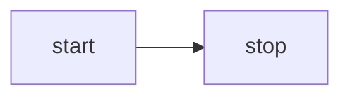

<script setup>
import Mermaid from '../../components/Mermaid.vue'
import MermaidRough from '../../components/MermaidRough.vue'
import MermaidFlowchart from '../../components/MermaidFlowchart.vue'
import MermaidFlowchartOutline from '../../components/MermaidFlowchartOutline.vue'
import MermaidSequence from '../../components/MermaidSequence.vue'
import MermaidState from '../../components/MermaidState.vue'
import D2 from '../../components/D2.vue'
import D2Containers from '../../components/D2Containers.vue'
import D2Connections from '../../components/D2Connections.vue'
import Drawio from '../../components/Drawio.vue'
</script>

# 32강 - 텍스트로 다이어그램 만들기 {#lesson-32-text-to-diagram}

이전 강의에서 도형 사이의 연결을 표현할 수 있게 했으므로, 이제 여러 종류의 다이어그램을 렌더할 수 있습니다. 대규모 모델은 [mermaid], [D2], [draw.io]처럼 텍스트 기반 다이어그램 언어를 잘 지원합니다.

## Mermaid {#mermaid}

Excalidraw는 [mermaid-to-excalidraw/api]를 제공합니다. 내부 구현이 궁금하면 공식 문서를 읽을 수 있습니다. [How the Parser works under the hood ?]


요약하면, Excalidraw는 Mermaid 다이어그램 유형 중 제한된 일부만 지원합니다. Mermaid 렌더러가 출력한 SVG를 파싱해 내부 씬 다이어그램 표현으로 바꾸고, 파서에서 얻은 Diagram JSON으로 노드 사이의 관계를 가져옵니다.

### 플로차트 {#flowchart}

아래의 가장 단순한 Mermaid 플로차트를 예로 듭니다.



먼저 Mermaid의 폐기된 API로 텍스트를 파싱하여 차트 유형, 노드, 간선 관계를 뽑아내지만, 기하 정보는 포함되지 않습니다.

```ts
import mermaid, { MermaidConfig } from 'mermaid';
const diagram = await mermaid.mermaidAPI.getDiagramFromText(definition); // "flowchart LR..."
```

그다음 Mermaid의 렌더링 방법으로 SVG를 페이지의 숨겨진 컨테이너에 렌더합니다. 이 방식의 한계도 여기서 드러납니다. 브라우저 환경에서만 실행할 수 있습니다. 렌더된 SVG 출력에서 노드와 간선의 기하 정보를 뽑으며, 이전 단계에서 얻은 노드와 간선 ID를 사용합니다.

```ts
const { svg } = await mermaid.render('mermaid-to-excalidraw', definition);
```

마지막으로 우리 캔버스가 받아들이는 씬 그래프로 변환하며, 노드 위의 텍스트는 별도의 자식 노드를 만듭니다.

```ts
function convertFlowchartToSerializedNodes(
    vertices: Map<string, Vertex>,
    edges: Edge[],
    options: { fontSize: number },
): SerializedNode[] {
    vertices.forEach((vertex) => {
        // Vertex
        const serializedNode: SerializedNode = {
            id: vertex.id,
            type: 'rect',
            x: vertex.x,
            y: vertex.y,
            width: vertex.width,
            height: vertex.height,
            stroke: 'black',
            strokeWidth: 2,
        };
        // Label of vertex
        const textSerializedNode: TextSerializedNode = {
            parentId: vertex.id,
            content: getText(vertex),
            //...
        };
    });
    // Edges
}
```

<Mermaid />

도형의 타입만 바꾸면 손그림 스타일 렌더링을 얻을 수 있습니다.

```ts
nodes.forEach((node) => {
    if (node.type === 'rect') {
        node.type = 'rough-rect';
    } else if (node.type === 'line') {
        node.type = 'rough-line';
    } else if (node.type === 'text') {
        node.fontFamily = 'Gaegu';
    }
});
```

<MermaidRough />

### 시퀀스 {#mermaid-sequence}

<MermaidSequence />

### [WIP] 상태 {#mermaid-state}

## D2 {#d2}

Mermaid와 비교하면, D2는 바로 쓸 수 있는 편리한 파서를 함께 제공합니다.

```ts
import { D2 } from '@terrastruct/d2';

const d2 = new D2();
const { diagram, graph } = await d2.compile(definition);
const { connections, shapes } = diagram;
const {
    theme: { colors },
} = graph;
```

```txt
x -> y: hello world
```

<D2 />

연결은 끝점 노드에 묶인 Path가 되며, 스트로크가 있고 `fills: []`입니다. 열린 패스를 채우면 끝점이 암묵적으로 이어져 영역이 되므로, 연결 색을 채우기로도 쓰면 안 됩니다. 노드가 움직여도 연결은 계속 갱신되며, 마커가 화살촉을 그립니다.

### 컨테이너 {#container}

```txt
good chips: {
  doritos
  ruffles
}
bad chips.lays
bad chips.pringles

chocolate.chip.cookies
```

<D2Containers />

### 연결 {#connections}

```txt
dogs -> cats -> mice: chase
replica 1 <-> replica 2
a -> b: To err is human, to moo bovine {
  source-arrowhead: 1
  target-arrowhead: * {
    shape: diamond
  }
}
```

<D2Connections />

## drawio {#drawio}

커뮤니티 파서를 사용할 수 있습니다.

```ts
import { parseDrawIO } from 'mxgraphdata';
const mxfile = await parseDrawIO(xml);
console.log(mxfile.diagram);
```

<Drawio />

## 간선 레이블 {#label-on-edge}

간선 위의 텍스트 레이블은 지오메트리를 따라 잘 고른 위치에 머물러야 합니다. 일반적인 접근은 다음 절 [33강 - 레이아웃 엔진]에서 다룹니다. 이 구체적인 문제에서는 Excalidraw, tldraw, draw.io가 어떻게 다루는지 비교하는 것이 도움이 됩니다.

### 별도 노드인가, 속성인가 {#node-or-attribute}

Excalidraw에서 간선(선/화살표)에 텍스트 레이블을 두는 일은, 근본적으로 “텍스트가 패스를 따라가거나 곡선을 따라 줄바꿈되게 하는 것”이 아닙니다. 대신 더 단순하고 믿을 만한 방법에 기댑니다.

1. 레이블은 독립된 텍스트 요소로 남습니다(선 자체의 일부로 렌더되지 않습니다).
2. 데이터에서 텍스트를 선(화살표/선)에 묶습니다. 텍스트는 “어느 선에 속하는지”를 기록하고, 선은 “자신의 레이블 텍스트 ID” 또는 동등한 관계를 기록합니다.
3. 기하 계산으로 텍스트에 앵커 점을 부여합니다. 보통 선의 “중점” 또는 labelPosition 매개변수(0~1)를 쓰고, 선의 모양(직선/꺾은선/곡선)에 따라 해당하는 점을 계산합니다.
4. 텍스트를 바인딩된 요소로 다룹니다. 선이 움직이거나, 끝점을 드래그하거나, 꺾임이 바뀌거나, 화살표가 뒤집히면 레이블 위치를 다시 계산하고 텍스트 좌표를 갱신합니다(선과의 겹침 회피, 오프셋, 정렬도 함께 처리합니다).

tldraw는 다른 접근을 취합니다. 레이블은 별도의 텍스트 도형이 아니라 화살표 도형 자체의 prop(richText)이며, 기하학적 위치 지정과 편집 상호작용이 함께 있습니다.

draw.io에서 간선(커넥터)에 텍스트 레이블을 두는 것은 핵심 기능 중 하나입니다. 구현은 전통적인 플로차트 편집기에 더 가깝습니다. “간선은 자신의 레이블(텍스트) 기능을 가지며, 레이블은 간선의 자식 상태로 존재하고, 위치는 기하 매개변수/오프셋으로 저장된다”는 방식이지, 별도의 텍스트 노드를 만들어 묶는 방식이 아닙니다.

### 우리의 구현 {#our-implementation}

Excalidraw식 모델을 따릅니다. 간선 위의 문구는 여전히 독립된 텍스트 노드이며, `parentId`로 폴리라인에 붙이고, `edgeLabelPosition`(폴리라인 전체 호 길이를 따라 0–1)으로 간선의 어느 위치에 있는지를 나타냅니다.

```ts
export interface TextSerializedNode
  extends BaseSerializeNode<'text'>,
  Partial<TextAttributes>,
  Partial<{
    /**
     * When set, this text is an edge label: parent should be a bound polyline/line.
     * Value is 0–1 along total edge length (arc-length parameter).
     */
    edgeLabelPosition: number;
  }>;
```

<MermaidFlowchart />

### 가독성 높이기 {#improve-readability}

간선 레이블은 가독성을 손볼 필요가 있는 경우가 많습니다. 특히 스트로크 바로 위에 겹쳐 앉지 않게 해야 합니다.

#### 배경 채우기 {#label-background}

불투명한 배경으로 아래의 선을 가릴 수 있습니다.

-   mxGraph(draw.io): `labelBackgroundColor` 스타일. 예를 들어 `labelBackgroundColor=white`는 레이블 뒤에 흰 상자를 더합니다. `labelBorderColor`로 테두리를 더할 수 있습니다.
-   tldraw: 화살표 레이블에는 전용 배경 옵션이 없지만, 텍스트 도형은 대비를 높이기 위해 `showTextOutline`을 지원합니다.
-   Excalidraw: 독립된 텍스트 요소로서 `backgroundColor`가 텍스트 뒤에 채운 사각형을 자동으로 그립니다.

#### 간격과 인셋 {#padding-inset}

법선 방향 오프셋과 내부 패딩은 글리프를 스트로크에서 물리적으로 떨어뜨립니다. `edgeLabelOffset` 속성을 추가했으며, `edgeLabelPosition`과 달리 절대 단위로 법선 방향의 오프셋을 정의합니다.

#### 자동 회피 {#conflict-avoidance}

스케치 스타일 도구인 Excalidraw와 tldraw는 겹침에 대한 무거운 자동 레이아웃을 피하고, 사용자가 레이블을 손으로 옮깁니다. 전문 다이어그램 편집기인 mxGraph(draw.io)는 더 세밀한 겹침 제어를 제공합니다.

#### 텍스트 외곽선 {#text-outline}

전체 배경보다 가벼운 대안입니다. 대비를 위해 글리프 주위에 스트로크나 그림자를 둡니다. tldraw는 `showTextOutline`이 켜져 있으면 텍스트 뒤에 얇은 외곽선을 그려, 겹쳐도 읽을 수 있게 합니다.

이 방법은 [16강 - 텍스트 스트로크]에서 이미 소개했습니다.

<MermaidFlowchartOutline />

## [WIP] 선 점프 {#line-jumps}


## 더 읽어보기 {#extended-reading}

-   [Discussion in HN]

[mermaid]: https://mermaid.js.org
[mermaid-to-excalidraw/api]: https://docs.excalidraw.com/docs/@excalidraw/mermaid-to-excalidraw/api
[How the Parser works under the hood ?]: https://docs.excalidraw.com/docs/@excalidraw/mermaid-to-excalidraw/codebase/parser
[D2]: https://github.com/terrastruct/d2
[draw.io]: https://app.diagrams.net/
[Discussion in HN]: https://news.ycombinator.com/item?id=44954524
[33강 - 레이아웃 엔진]: /ko/guide/lesson-033
[16강 - 텍스트 스트로크]: /ko/guide/lesson-016#text-stroke
