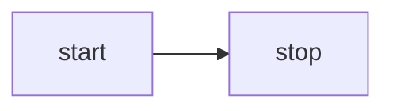

<script setup>
import Mermaid from '../../components/Mermaid.vue'
import MermaidRough from '../../components/MermaidRough.vue'
import MermaidFlowchart from '../../components/MermaidFlowchart.vue'
import MermaidFlowchartOutline from '../../components/MermaidFlowchartOutline.vue'
import MermaidSequence from '../../components/MermaidSequence.vue'
import MermaidState from '../../components/MermaidState.vue'
import D2 from '../../components/D2.vue'
import D2Containers from '../../components/D2Containers.vue'
import D2Connections from '../../components/D2Connections.vue'
import Drawio from '../../components/Drawio.vue'
</script>

# Lição 32 - Texto para diagrama {#lesson-32-text-to-diagram}

Na lição anterior, habilitamos a expressão de conexões entre gráficos, o que significa que agora dá para renderizar muitos tipos de diagramas. Os modelos grandes oferecem excelente suporte a várias linguagens de diagramação baseadas em texto, como [mermaid], [D2] e [draw.io].

## Mermaid {#mermaid}

O Excalidraw oferece a [mermaid-to-excalidraw/api]. Se você tiver interesse na implementação interna, dá para ler a documentação oficial: [How the Parser works under the hood ?]


Em resumo, o Excalidraw oferece suporte apenas a um subconjunto limitado de tipos de diagrama do Mermaid. Ele analisa a saída SVG do renderizador do Mermaid, converte isso em uma representação interna de diagrama de cena e usa o JSON do diagrama obtido do parser para recuperar as relações entre os nós.

### Fluxograma {#flowchart}

Tome como exemplo o fluxograma Mermaid mais simples abaixo:



Primeiro, a API obsoleta do Mermaid é usada para analisar o texto, extraindo tipos de diagrama, nós e relações de arestas, mas sem informação geométrica:

```ts
import mermaid, { MermaidConfig } from 'mermaid';
const diagram = await mermaid.mermaidAPI.getDiagramFromText(definition); // "flowchart LR..."
```

Depois use o método de renderização do Mermaid para renderizar o SVG em um contêiner oculto na página. Isso também revela as limitações dessa abordagem: ela só pode ser executada em um ambiente de navegador. Extraia a informação geométrica de nós e arestas da saída SVG renderizada, usando os IDs de nó e de aresta obtidos no passo anterior:

```ts
const { svg } = await mermaid.render('mermaid-to-excalidraw', definition);
```

Por fim, converta isso em um grafo de cena aceito pela nossa tela, com o texto nos nós criando nós filhos separados:

```ts
function convertFlowchartToSerializedNodes(
    vertices: Map<string, Vertex>,
    edges: Edge[],
    options: { fontSize: number },
): SerializedNode[] {
    vertices.forEach((vertex) => {
        // Vertex
        const serializedNode: SerializedNode = {
            id: vertex.id,
            type: 'rect',
            x: vertex.x,
            y: vertex.y,
            width: vertex.width,
            height: vertex.height,
            stroke: 'black',
            strokeWidth: 2,
        };
        // Label of vertex
        const textSerializedNode: TextSerializedNode = {
            parentId: vertex.id,
            content: getText(vertex),
            //...
        };
    });
    // Edges
}
```

<Mermaid />

Basta substituir o tipo dos gráficos para obter a renderização no estilo de esboço:

```ts
nodes.forEach((node) => {
    if (node.type === 'rect') {
        node.type = 'rough-rect';
    } else if (node.type === 'line') {
        node.type = 'rough-line';
    } else if (node.type === 'text') {
        node.fontFamily = 'Gaegu';
    }
});
```

<MermaidRough />

### Sequência {#mermaid-sequence}

<MermaidSequence />

### [WIP] Estado {#mermaid-state}

## D2 {#d2}

Em comparação com o Mermaid, o D2 já vem com um parser conveniente.

```ts
import { D2 } from '@terrastruct/d2';

const d2 = new D2();
const { diagram, graph } = await d2.compile(definition);
const { connections, shapes } = diagram;
const {
    theme: { colors },
} = graph;
```

```txt
x -> y: hello world
```

<D2 />

As conexões viram Paths vinculados aos nós das extremidades, com um traço e `fills: []`. Preencher um caminho aberto junta implicitamente as extremidades em uma área, então a cor da conexão não pode ser usada também como preenchimento. As conexões continuam sendo atualizadas quando os nós se movem, e os marcadores desenham as pontas de seta.

### Contêiner {#container}

```txt
good chips: {
  doritos
  ruffles
}
bad chips.lays
bad chips.pringles

chocolate.chip.cookies
```

<D2Containers />

### Conexões {#connections}

```txt
dogs -> cats -> mice: chase
replica 1 <-> replica 2
a -> b: To err is human, to moo bovine {
  source-arrowhead: 1
  target-arrowhead: * {
    shape: diamond
  }
}
```

<D2Connections />

## drawio {#drawio}

Há um parser da comunidade disponível:

```ts
import { parseDrawIO } from 'mxgraphdata';
const mxfile = await parseDrawIO(xml);
console.log(mxfile.diagram);
```

<Drawio />

## Rótulo da aresta {#label-on-edge}

Os rótulos de texto nas arestas devem permanecer em uma posição bem escolhida ao longo da geometria; vamos tratar de uma abordagem geral na próxima seção, [Lição 33 - Motor de layout]. Para este problema específico, ajuda comparar como o Excalidraw, o tldraw e o draw.io tratam isso.

### Nó separado ou atributo {#node-or-attribute}

No Excalidraw, colocar rótulos de texto nas arestas (linhas/setas) não trata, no fundo, de “fazer o texto seguir caminhos ou envolver ao longo de curvas”. Em vez disso, ele se apoia em uma abordagem mais simples e confiável:

1. O rótulo continua sendo um elemento de texto independente (não é renderizado como parte da própria linha).
2. Vincule o texto à linha (seta/linha) nos dados: o texto registra “a qual linha ele pertence”, e a linha registra “o ID do texto do rótulo” ou uma relação equivalente.
3. Use cálculos geométricos para atribuir um ponto de âncora ao texto: em geral o “ponto médio” da linha ou um parâmetro labelPosition (0~1) e, em seguida, calcule o ponto correspondente com base na forma da linha (reta/poligonal/curva).
4. Trate o texto como um elemento vinculado: quando a linha se move, as extremidades são arrastadas, as dobras mudam ou as setas invertem, a posição do rótulo é recalculada e as coordenadas do texto são atualizadas (tratando também de evitar sobreposição com a linha, deslocamento e alinhamento).

O tldraw adota uma abordagem diferente: o rótulo não é uma forma de texto separada, mas uma prop (richText) da própria forma de seta, combinada com um conjunto de posicionamento geométrico e interações de edição.

No draw.io, colocar rótulos de texto nas arestas (conectores) é uma das capacidades centrais. A implementação se alinha mais de perto com os editores de fluxograma tradicionais: “as arestas possuem a própria funcionalidade de rótulo (texto), em que os rótulos existem como estados filhos da aresta, com posições armazenadas por meio de parâmetros e deslocamentos geométricos”, em vez de criar um nó de texto separado e vinculá-lo.

### Nossa implementação {#our-implementation}

Seguimos o modelo no estilo do Excalidraw: o texto da aresta continua sendo um nó de texto independente, anexado à polilinha por meio de `parentId`, com `edgeLabelPosition` (0–1 ao longo do comprimento de arco total da polilinha) indicando onde ele fica ao longo da aresta.

```ts
export interface TextSerializedNode
  extends BaseSerializeNode<'text'>,
  Partial<TextAttributes>,
  Partial<{
    /**
     * When set, this text is an edge label: parent should be a bound polyline/line.
     * Value is 0–1 along total edge length (arc-length parameter).
     */
    edgeLabelPosition: number;
  }>;
```

<MermaidFlowchart />

### Melhorar a legibilidade {#improve-readability}

Os rótulos de aresta muitas vezes precisam de ajustes de legibilidade, sobretudo para evitar ficar exatamente em cima do traço.

#### Preenchimento de fundo {#label-background}

Um fundo opaco pode esconder a linha que está por baixo.

-   mxGraph (draw.io): estilo `labelBackgroundColor`, por exemplo `labelBackgroundColor=white` acrescenta uma caixa branca atrás do rótulo. `labelBorderColor` pode acrescentar uma borda.
-   tldraw: os rótulos de seta não expõem uma opção dedicada de fundo, mas as formas de texto oferecem suporte a `showTextOutline` para maior contraste.
-   Excalidraw: como elementos de texto independentes, `backgroundColor` desenha automaticamente um retângulo preenchido atrás do texto.

#### Espaçamento e recuo {#padding-inset}

O deslocamento perpendicular e o padding interno mantêm os glifos fisicamente afastados do traço. Acrescentamos a propriedade `edgeLabelOffset` que, ao contrário de `edgeLabelPosition`, usa unidades absolutas para definir o deslocamento ao longo da direção da normal.

#### Desvio automático {#conflict-avoidance}

O Excalidraw e o tldraw, como ferramentas no estilo de esboço, evitam um layout automático pesado para sobreposições; o usuário ajusta os rótulos à mão. O mxGraph (draw.io), como editor profissional de diagramas, oferece um controle mais fino de sobreposição.

#### Contorno de texto {#text-outline}

Uma alternativa mais leve a um fundo completo: traço ou sombra ao redor dos glifos para contraste. O tldraw desenha um contorno fino atrás do texto quando `showTextOutline` está habilitado, para que ele continue legível quando há sobreposição.

Já apresentamos esse método na [Lição 16 - Traço de texto].

<MermaidFlowchartOutline />

## [WIP] Saltos de linha {#line-jumps}


## Leitura adicional {#extended-reading}

-   [Discussion in HN]

[mermaid]: https://mermaid.js.org
[mermaid-to-excalidraw/api]: https://docs.excalidraw.com/docs/@excalidraw/mermaid-to-excalidraw/api
[How the Parser works under the hood ?]: https://docs.excalidraw.com/docs/@excalidraw/mermaid-to-excalidraw/codebase/parser
[D2]: https://github.com/terrastruct/d2
[draw.io]: https://app.diagrams.net/
[Discussion in HN]: https://news.ycombinator.com/item?id=44954524
[Lição 33 - Motor de layout]: /pt-BR/guide/lesson-033
[Lição 16 - Traço de texto]: /pt-BR/guide/lesson-016#text-stroke
