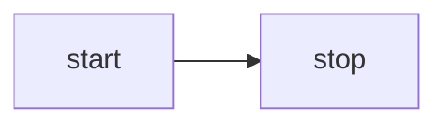

<script setup>
import Mermaid from '../../components/Mermaid.vue'
import MermaidRough from '../../components/MermaidRough.vue'
import MermaidFlowchart from '../../components/MermaidFlowchart.vue'
import MermaidFlowchartOutline from '../../components/MermaidFlowchartOutline.vue'
import MermaidSequence from '../../components/MermaidSequence.vue'
import MermaidState from '../../components/MermaidState.vue'
import D2 from '../../components/D2.vue'
import D2Containers from '../../components/D2Containers.vue'
import D2Connections from '../../components/D2Connections.vue'
import Drawio from '../../components/Drawio.vue'
</script>

# 第 32 課 - 文字轉圖表 {#lesson-32-text-to-diagram}

在上一節，我們讓圖形之間的連接可以被表達，因此現在可以渲染許多類型的圖表。大型模型對多種以文字為基礎的圖表語言提供了很好的支援，例如 [mermaid]、[D2] 與 [draw.io]。

## Mermaid {#mermaid}

Excalidraw 提供 [mermaid-to-excalidraw/api]。如果對它的內部實作有興趣，可以閱讀官方文件：[剖析器在底層如何運作？]


簡而言之，Excalidraw 只支援有限的 Mermaid 圖表類型子集。它剖析 Mermaid 渲染器輸出的 SVG，轉換成內部的場景圖表示，並使用從剖析器取得的 Diagram JSON 來取得節點之間的關係。

### 流程圖 {#flowchart}

以下面最簡單的 Mermaid 流程圖為例：



首先使用 Mermaid 已棄用的 API 剖析文字，取出圖表類型、節點與邊的關係，但不含幾何資訊：

```ts
import mermaid, { MermaidConfig } from 'mermaid';
const diagram = await mermaid.mermaidAPI.getDiagramFromText(definition); // "flowchart LR..."
```

接著用 Mermaid 的渲染方法，把 SVG 渲染到頁面上的隱藏容器。這也暴露了這個做法的限制：它只能在瀏覽器環境中執行。從渲染後的 SVG 輸出中取出節點與邊的幾何資訊，並使用上一步取得的節點與邊 ID：

```ts
const { svg } = await mermaid.render('mermaid-to-excalidraw', definition);
```

最後，轉換成我們的畫布所接受的場景圖，節點上的文字會建立成獨立的子節點：

```ts
function convertFlowchartToSerializedNodes(
    vertices: Map<string, Vertex>,
    edges: Edge[],
    options: { fontSize: number },
): SerializedNode[] {
    vertices.forEach((vertex) => {
        // Vertex
        const serializedNode: SerializedNode = {
            id: vertex.id,
            type: 'rect',
            x: vertex.x,
            y: vertex.y,
            width: vertex.width,
            height: vertex.height,
            stroke: 'black',
            strokeWidth: 2,
        };
        // Label of vertex
        const textSerializedNode: TextSerializedNode = {
            parentId: vertex.id,
            content: getText(vertex),
            //...
        };
    });
    // Edges
}
```

<Mermaid />

只要替換圖形的型別，就能得到手繪風格的渲染：

```ts
nodes.forEach((node) => {
    if (node.type === 'rect') {
        node.type = 'rough-rect';
    } else if (node.type === 'line') {
        node.type = 'rough-line';
    } else if (node.type === 'text') {
        node.fontFamily = 'Gaegu';
    }
});
```

<MermaidRough />

### 循序圖 {#mermaid-sequence}

<MermaidSequence />

### [WIP] 狀態 {#mermaid-state}

## D2 {#d2}

與 Mermaid 相比，D2 一開始就附帶方便的剖析器。

```ts
import { D2 } from '@terrastruct/d2';

const d2 = new D2();
const { diagram, graph } = await d2.compile(definition);
const { connections, shapes } = diagram;
const {
    theme: { colors },
} = graph;
```

```txt
x -> y: hello world
```

<D2 />

連接會變成綁定到端點節點的 Path，帶有描邊與 `fills: []`。為開放路徑填色會隱含地把端點接合成一個區域，因此連接的顏色不能同時被拿來當填色。節點移動時連接仍然會更新，標記則畫出箭頭。

### 容器 {#container}

```txt
good chips: {
  doritos
  ruffles
}
bad chips.lays
bad chips.pringles

chocolate.chip.cookies
```

<D2Containers />

### 連接 {#connections}

```txt
dogs -> cats -> mice: chase
replica 1 <-> replica 2
a -> b: To err is human, to moo bovine {
  source-arrowhead: 1
  target-arrowhead: * {
    shape: diamond
  }
}
```

<D2Connections />

## drawio {#drawio}

可以使用社群剖析器：

```ts
import { parseDrawIO } from 'mxgraphdata';
const mxfile = await parseDrawIO(xml);
console.log(mxfile.diagram);
```

<Drawio />

## 邊標籤 {#label-on-edge}

邊上的文字標籤應該停留在沿著幾何妥善選好的位置；一般做法會在下一節 [第 33 課 - 版面引擎] 介紹。針對這個具體問題，比較 Excalidraw、tldraw 與 draw.io 的處理方式會有幫助。

### 獨立節點還是屬性 {#node-or-attribute}

在 Excalidraw 中，把文字標籤放在邊（直線／箭頭）上，根本上並不是「讓文字沿著路徑走，或沿著曲線換行」。它依賴一種更簡單、也更可靠的做法：

1. 標籤仍然是獨立的文字元素（不是線條本身的一部分來渲染）。
2. 在資料中把文字綁定到線（箭頭／直線）：文字記錄「它屬於哪一條線」，線則記錄「它的標籤文字 ID」或等價的關係。
3. 用幾何計算為文字指定錨點：通常是線的「中點」，或一個 labelPosition 參數（0~1），再依照線的形狀（直線／折線／曲線）計算對應的點。
4. 把文字視為被綁定的元素：當線移動、端點被拖曳、轉折改變或箭頭翻轉時，重新計算標籤位置並更新文字座標（同時處理與線重疊的迴避、偏移與對齊）。

tldraw 採取不同做法：標籤不是獨立的文字圖形，而是箭頭圖形本身的一個 prop（richText），並結合一套幾何定位與編輯互動。

在 draw.io 中，把文字標籤放在邊（連接器）上是它的核心能力之一。它的實作更接近傳統流程圖編輯器：「邊擁有自己的標籤（文字）功能，標籤作為邊的子狀態存在，位置透過幾何參數／偏移儲存」，而不是建立獨立的文字節點再綁定。

### 我們的實作 {#our-implementation}

我們遵循 Excalidraw 風格的模型：邊上的文字仍然是獨立的文字節點，透過 `parentId` 附在折線上，並用 `edgeLabelPosition`（沿折線總弧長的 0–1）表示它位於邊上的哪裡。

```ts
export interface TextSerializedNode
  extends BaseSerializeNode<'text'>,
  Partial<TextAttributes>,
  Partial<{
    /**
     * When set, this text is an edge label: parent should be a bound polyline/line.
     * Value is 0–1 along total edge length (arc-length parameter).
     */
    edgeLabelPosition: number;
  }>;
```

<MermaidFlowchart />

### 提升可讀性 {#improve-readability}

邊標籤常常需要為了可讀性做調整，尤其是避免直接壓在描邊正上方。

#### 背景填色 {#label-background}

不透明的背景可以遮住底下的線。

-   mxGraph（draw.io）：`labelBackgroundColor` 樣式，例如 `labelBackgroundColor=white` 會在標籤後面加上白框。`labelBorderColor` 可以加上邊框。
-   tldraw：箭頭標籤沒有專用的背景選項，但文字圖形支援 `showTextOutline`，以提高對比。
-   Excalidraw：作為獨立的文字元素，`backgroundColor` 會自動在文字後面畫一個填色矩形。

#### 間距與內縮 {#padding-inset}

垂直於線的偏移與內部留白，讓字形在實體上離開描邊。我們加入了 `edgeLabelOffset` 屬性；與 `edgeLabelPosition` 不同，它用絕對單位定義沿法線方向的偏移。

#### 自動迴避 {#conflict-avoidance}

Excalidraw 與 tldraw 作為草圖風格的工具，避免對重疊做沉重的自動版面；使用者用手挪動標籤。mxGraph（draw.io）作為專業圖表編輯器，提供更細的重疊控制。

#### 文字外框 {#text-outline}

這是完整背景之外較輕的替代：在字形周圍加上描邊或陰影以提高對比。tldraw 在啟用 `showTextOutline` 時，會在文字後面畫一層細外框，讓重疊時仍然可讀。

我們已經在 [第 16 課 - 文字描邊] 介紹過這個方法。

<MermaidFlowchartOutline />

## [WIP] 跳線 {#line-jumps}


## 延伸閱讀 {#extended-reading}

-   [HN 上的討論]

[mermaid]: https://mermaid.js.org
[mermaid-to-excalidraw/api]: https://docs.excalidraw.com/docs/@excalidraw/mermaid-to-excalidraw/api
[剖析器在底層如何運作？]: https://docs.excalidraw.com/docs/@excalidraw/mermaid-to-excalidraw/codebase/parser
[D2]: https://github.com/terrastruct/d2
[draw.io]: https://app.diagrams.net/
[HN 上的討論]: https://news.ycombinator.com/item?id=44954524
[第 33 課 - 版面引擎]: /zh-Hant/guide/lesson-033
[第 16 課 - 文字描邊]: /zh-Hant/guide/lesson-016#text-stroke
